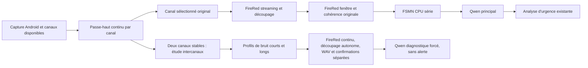

# Guardian Voice : architecture conservée et voie de recherche

La voie originale reste la référence fonctionnelle. La v3.4.9 a corrigé le crash d'affinité OpenMP de FSMN ; la v3.5.0 ajoute un traitement intercanaux volontairement diagnostique. La v3.5.1 ajoute son propre FireRed continu et son découpeur corrigé, indépendants des fenêtres principales. Une transcription exacte obtenue en forçant Qwen ne prouve pas que les gardes acoustiques ou le moteur complet ont validé la parole.

## Quel Wiener est conservé

| Traitement | Mode | Rôle exact |
|---|---|---|
| Wiener mono decision-directed adaptatif, conservateur | `WIENER_STUDY` | Comparaison par canal ; repli diagnostique explicite lorsqu'un seul signal est exploitable. Masque plancher 0,5, lissage temporel/fréquentiel et estimation adaptative du bruit déjà présents. |
| Prédicteur de Wiener intercanaux, transfert figé après apprentissage | `REFERENCE_NOISE_STUDY` | Nouvelle étude : estime H=S01/(S11+r), puis X0−H×X1 pour atténuer le bruit commun. Deux profils comparés, 0,5–3 s et 2–15 s. |
| GTCRN | Anciens modes de comparaison dédiés | Conservé dans le dépôt pour les comparaisons, désactivé dans le nouveau mode intercanaux. |

Le mode normal `ORIGINAL` conserve son gain automatique et son limiteur existants. Les modes d’étude utilisent une capture et un découpage à gain unitaire pour comparer les traitements sur le même signal ; ils ne modifient pas la politique de gain normale.

Les deux Wiener ne sont pas mis en cascade. Le nouveau traitement ne remplace pas automatiquement le PCM original envoyé à Qwen. En l'absence de paire utile, l'étude intercanaux est déclarée non applicable et la voie originale continue ; `WIENER_STUDY` reste disponible pour comparer le Wiener mono.

## Ce que démontre l'étude et ce qui reste ouvert

Sur le dernier test reçu, le téléphone a publié zéro phrase exacte sur trois à 3 m sous aspirateur et trois sur trois à 5 m au calme. Le prototype intercanaux a permis au même Qwen de retrouver les trois phrases bruitées dans le meilleur rejeu, avec un préfixe long sans parole et deux secondes de contexte supplémentaires. Le profil court et les fenêtres d'origine ne retrouvaient que deux phrases complètes. Ces réglages ont été comparés sur ce même enregistrement ; ce n'est pas une validation indépendante.

FSMN refuse encore la première fenêtre bruitée après traitement, même quand Qwen forcé la reconnaît. Les deux anciens faux restent refusés par FSMN dans ce petit contrôle ; Silero et TEN ne qualifient pas une substitution. Les gardes de la voie principale restent donc inchangées. La prochaine question est la confirmation fiable de parole sur un signal bruité, puis le découpage et les mots courts, sans réintroduire les faux.

## Capture et calibration

Android peut exposer des canaux déjà traités. Les indices ne désignent pas automatiquement des microphones physiques identifiés. La nouvelle étude utilise les deux premiers indices porteurs de signal, puis conserve cette paire jusqu'à une rupture de route ou de couverture. Ce choix est journalisé ; il n'est pas présenté comme une sélection ASR optimale parmi tous les microphones.

La capture AUTO actuelle privilégie la structure de la route — canaux indépendants/utiles/ouverts — avant la sélection à l'intérieur de cette route. Elle n'a pas mesuré simultanément la précision de MIC et de VOICE_RECOGNITION. Toutes les sources supplémentaires continuent d'être exportées par les diagnostics de capture lorsqu'elles sont disponibles.

Le profil de bruit est une hypothèse du protocole : aucune parole pendant son apprentissage. L'activité du VAD durant ce préfixe est enregistrée, sans transformer son absence en preuve de silence. Le transfert reste figé dans chaque époque ; déplacement, nouvelle acoustique ou parole dans le préfixe peuvent le rendre mauvais ou effacer de la voix. Le mode est destiné à mesurer ces limites.

## Limites et ressources

Le DSP est continu, borné et aligné sur l'horloge d'échantillons : Hann 512, saut 256, FFT 1024, fondu 100 ms. Aucun gain, limiteur ou remplissage de silence n'est ajouté à la nouvelle voie. La fin STFT non finalisée reste absente des fenêtres comparables. Les seuls zéros rejoués au début sont ceux garantis par le contrat de capture pour des canaux encore entièrement nuls ; un payload manquant n'est jamais remplacé par des zéros.

Les fenêtres EXACT et END_PLUS_2S sont séparées. L'extension attend de vrais échantillons, respecte les frontières de route et la limite de huit secondes ; un contexte indisponible ou trop long est signalé et non fabriqué. La rétention est limitée à seize secondes par époque, quatre époques simultanées et 32 époques par étude. La capture diagnostique est limitée à 180 s et 64 fenêtres initiales.

La nouvelle voie partage l'unique Qwen via sa file diagnostique de deux tâches en attente ; les finales principales restent prioritaires. Les modèles FireRed/FSMN de comparaison appartiennent au worker d'étude et sont libérés sur ce worker. Une saturation ou une erreur invalide l'étude et conserve les fichiers récupérables ; elle ne constitue pas une admission vocale.

Les compteurs `processingWallMs` et `threadCpuMs` de cette voie mesurent le travail des blocs DSP et de leur écriture ; ils ne mesurent pas les validations FireRed/FSMN ni Qwen. La consommation et la stabilité du nouveau code sur téléphone restent à mesurer. Cette livraison ne promet pas une baisse de mémoire de Qwen ni une fiabilité universelle sur toutes les langues, tous les téléphones ou tous les bruits.

La v3.5.1 réserve les IDs filtrés à partir de 1e9, propose en priorité deux secondes réelles de contexte et conserve un repli exact. Les fenêtres filtrées ne dépendent plus d’un événement de parole du canal principal. Les résultats diagnostiques demeurent sans alerte ; aucune nouvelle règle de confirmation n’a été qualifiée par les essais du 29 octobre.
